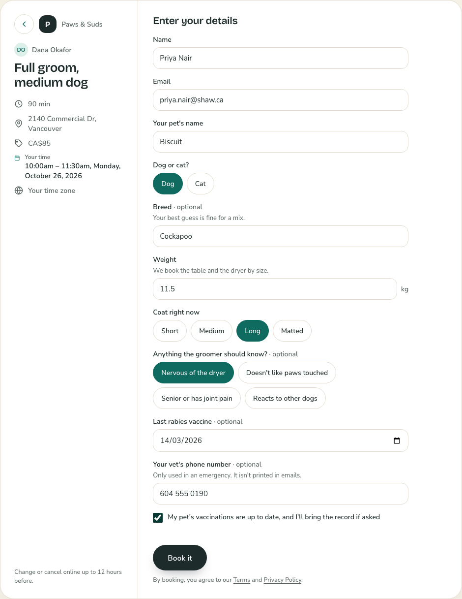
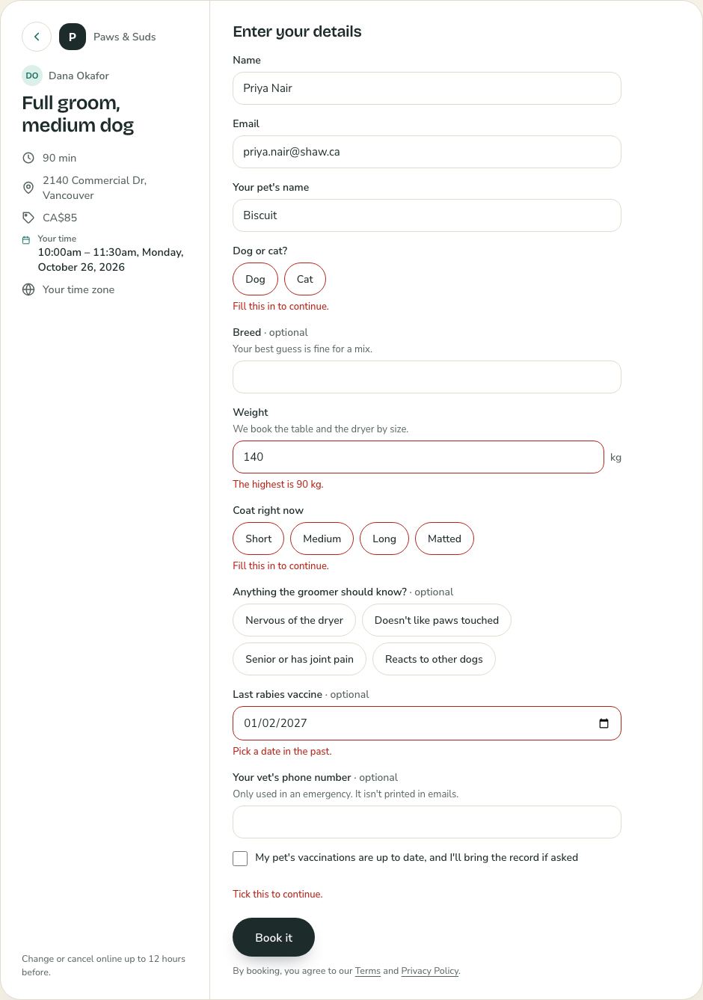
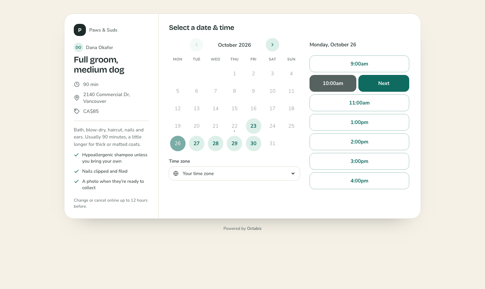
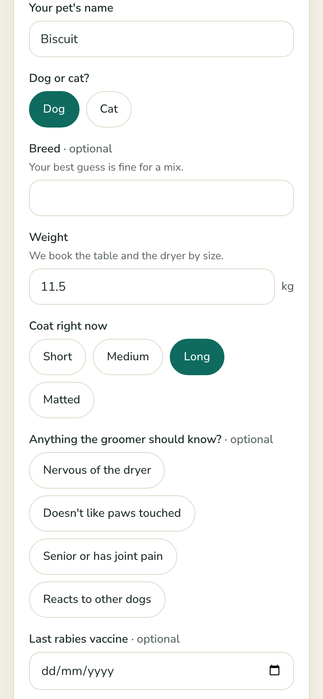

# Paws & Suds: custom booking fields

A dog and cat groomer needs to know who's coming before they arrive: the pet's name, size, coat, anything that makes them nervous, and whether their vaccines are current. This theme adds those nine questions to the built-in **Your details** page. It has no HTML at all, just one `theme.json`.

> Uses the **preview** part of the booking theme contract (`fields`). It runs in `tools/preview.mjs` and passes `validate.mjs`; the developer portal doesn't accept it yet. See [docs/booking-themes.md](../../docs/booking-themes.md#custom-fields-preview).

| Filled in | What Octabiz checks |
| --- | --- |
|  |  |

| The service page, in the theme's colours | Phone |
| --- | --- |
|  |  |

## The fields

| Field | Type | Why it's built this way |
| --- | --- | --- |
| `pet_name` | `text`, required | Staff greet the pet by name |
| `species` | `select` as chips, required | Two choices fit on one line, so chips beat a dropdown |
| `breed` | `text` | Optional, because a lot of dogs are mixes |
| `weight_kg` | `number`, 1–90, `unit: "kg"` | The salon books the table and dryer by size, so the limits are real |
| `coat` | `select` as chips, required | "Matted" means extra time, so it can't be skipped |
| `handling` | `multiselect` as chips | Several can be true at once |
| `rabies_date` | `date`, `dates: "past"` | A vaccine date can't be in the future |
| `vet_phone` | `phone`, `sensitive` | Kept out of emails and calendar invites, so only staff see it |
| `vaccines_ok` | `checkbox`, required | A required checkbox is a consent the customer has to tick |

Octabiz runs the same checks on the server, so a wrong answer can't get through by skipping the form. The answers are stored with the appointment, and staff see them under these labels.

## Run it

```bash
node tools/preview.mjs examples/booking-fields-paws-grooming     # open "Your details" in the top bar
node tools/validate.mjs examples/booking-fields-paws-grooming
node tools/pack.mjs examples/booking-fields-paws-grooming        # → dist/booking-fields-paws-grooming-1.0.0.booking-theme.json
```

`preview.json` holds the sample salon the preview shows. It isn't part of the package.
