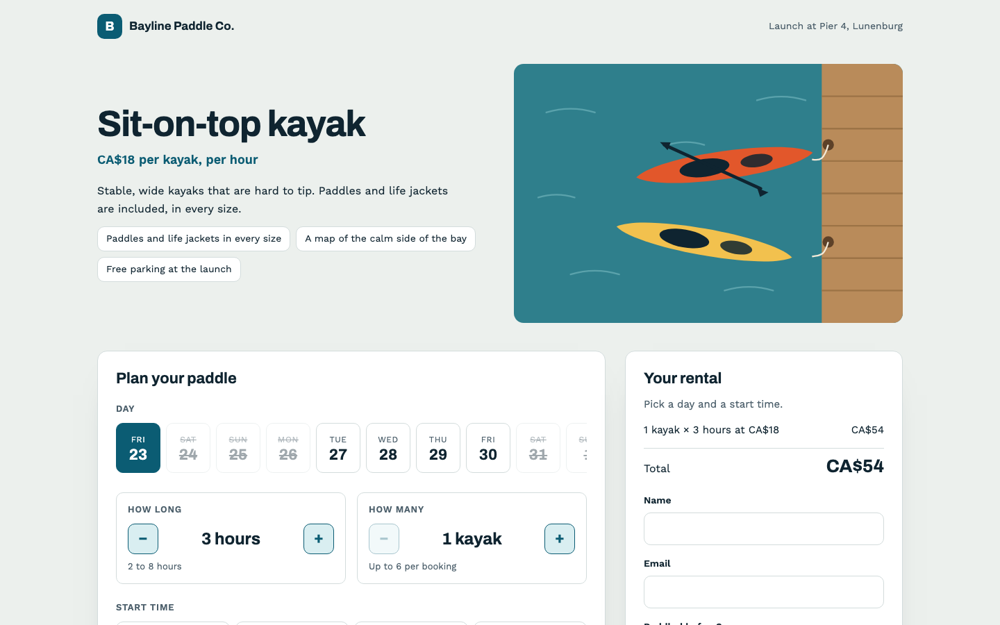
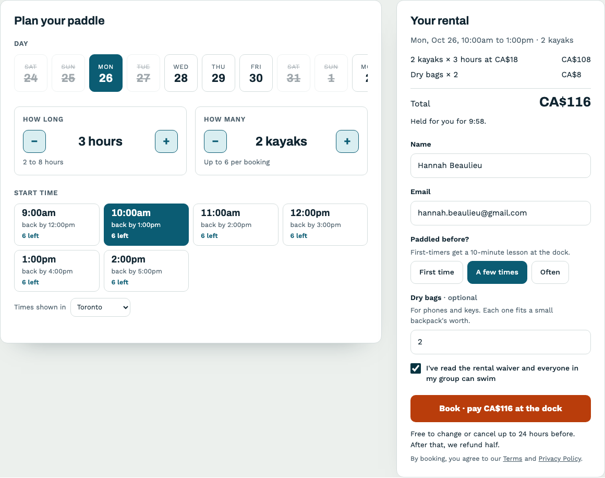
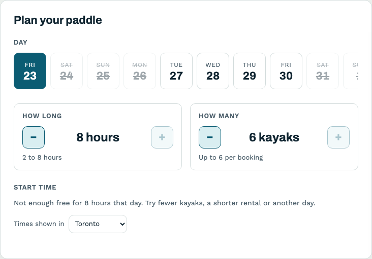
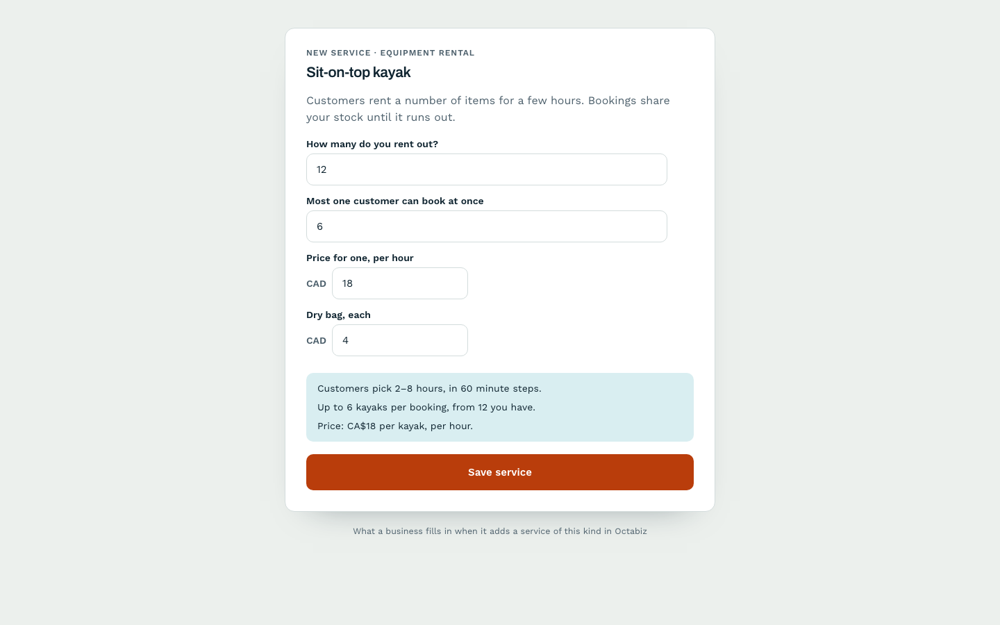
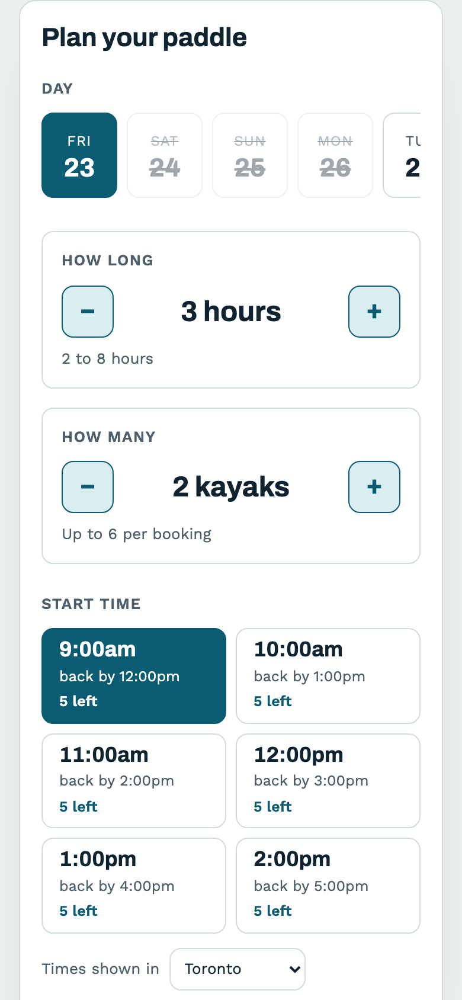
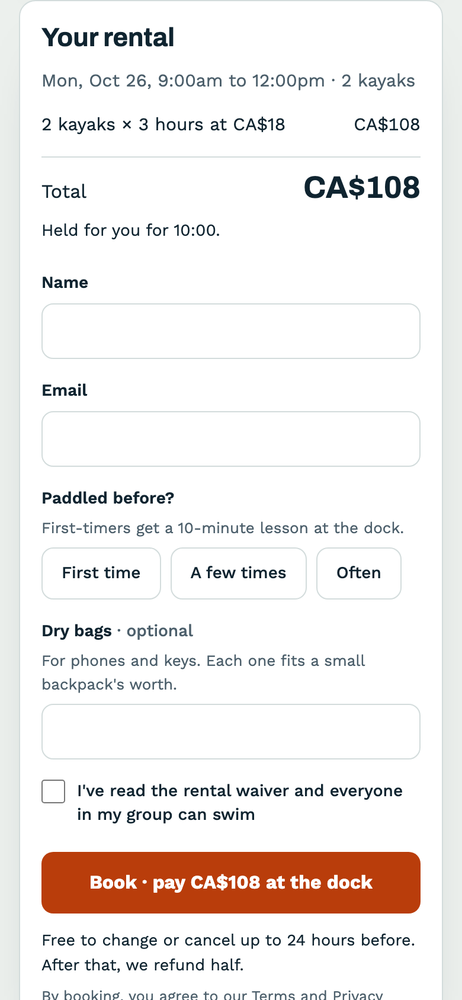

# Bayline: a new service kind (equipment rental)

Octabiz books appointments, classes, visits and walk-ins. It has no rentals: "two kayaks for three hours, from a dozen we own". This theme adds that as a new **service kind**.

The kind is built from blocks the booking engine already checks:

- **Length:** the customer picks it, from 2 to 8 hours.
- **Stock:** a pool of items that bookings share until it runs out.
- **Price:** per kayak, per hour, plus dry bags.

The business fills in four settings. Customers book on a page made for renting.

> Uses `serviceKinds` and custom fields, which the developer portal accepts. Businesses see kind pages on dev.octabiz.ai for now. Customers pay at the dock: a kind paid when booking waits for the payment frame. See [docs/booking-themes.md](../../docs/booking-themes.md#new-service-kinds-preview).





| Not enough left | What the business fills in | Phone |
| --- | --- | --- |
|  |  |   |

## The kind

```json
{
  "id": "rental",
  "name": "Equipment rental",
  "time":     { "mode": "range", "minMinutes": 120, "maxMinutes": 480, "stepMinutes": 60 },
  "capacity": { "mode": "units", "unitLabel": "kayak", "unitLabelPlural": "kayaks" },
  "pricing":  { "per": ["unit", "hour"], "rate": "settings.hourly_rate", "upfront": false,
                "addOns": [{ "field": "dry_bags", "each": "settings.dry_bag_price", "label": "Dry bags" }] },
  "settings": [ "units_total → capacity.total", "max_per_booking → capacity.maxPerBooking", "hourly_rate", "dry_bag_price" ],
  "page": "booking/rental.html"
}
```

(`settings` is shortened here; see `theme.json` for the full entries.)

What Octabiz does with it:

- **Stock.** It only offers a start time when that many kayaks are free for the whole rental, counting every other booking and hold that overlaps. The page asks `getSlots(…, { minutes, quantity })` and shows `remaining`; it never counts stock itself.
- **Price.** `quote()` works it out from the rules: 2 kayaks × 3 hours × CA$18, plus 2 dry bags × CA$4. Taxes, refunds and gift cards apply as usual. The page shows the lines it gets back.
- **Holds.** `hold()` holds the length and the quantity together, so changing either one lets the hold go and asks for a start time again.
- **Fields for this kind only.** `experience`, `dry_bags` and `waiver` have `"appliesTo": ["rental"]`, so they never show on the business's other services.

## What's in it

```
theme.json            tokens (sea fog, marine, buoy orange; Archivo and Work Sans), three fields and the rental kind
booking/rental.html   the rental page: day strip, length and quantity steppers, start times, summary and payment
booking/rental.css    a dock-board look with big tabular numbers; colours and corners from var(--bk-*)
booking/rental.js     calls getMonth, getSlots, hold, quote, readFields and book. Nothing else
preview.json          the sample business for the preview tool (not uploaded)
preview/cover.svg     its cover image (not uploaded)
```

## Run it

```bash
node tools/preview.mjs examples/booking-kind-bayline-rentals    # "Business setup" in the top bar shows the settings form
node tools/validate.mjs examples/booking-kind-bayline-rentals
node tools/pack.mjs examples/booking-kind-bayline-rentals       # → dist/booking-kind-bayline-rentals-1.0.0.zip
```

## Make your own kind

Start from the blocks: `time.mode` (`fixed`, `choice`, `range`), `capacity.mode` (`one`, `seats`, `units`) and `pricing.per` (`booking`, `person`, `unit`, `hour`). Bike hire is this example with other labels. A boat tour is `fixed` + `seats` + `per: ["person"]`. A room by the hour is `range` + `one` + `per: ["hour"]`. If what you need doesn't fit these blocks, post it under **Requests** in the developer portal.
