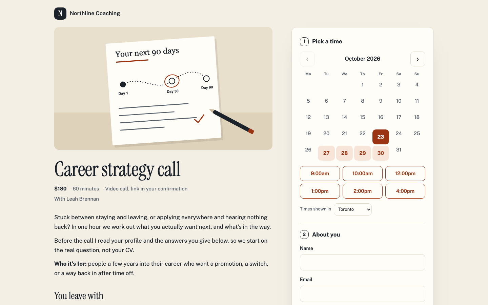
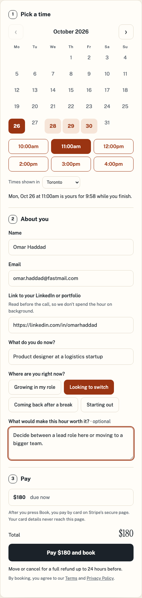
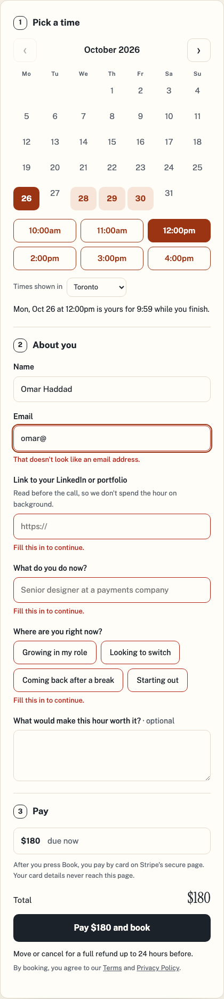
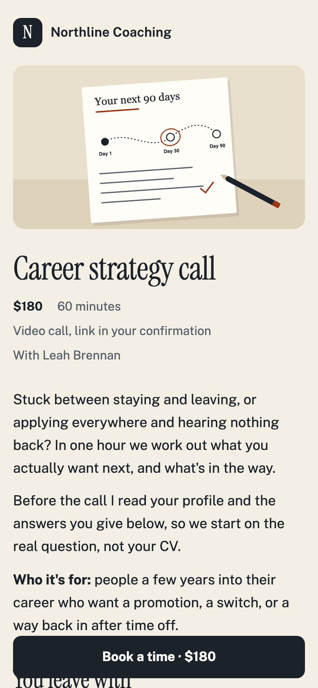
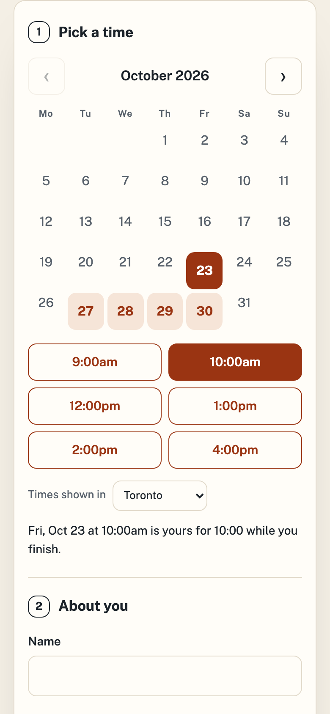
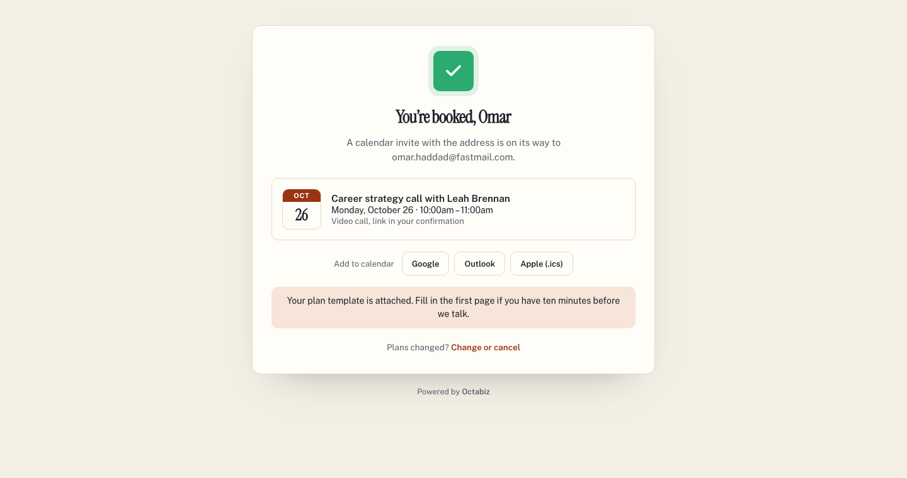
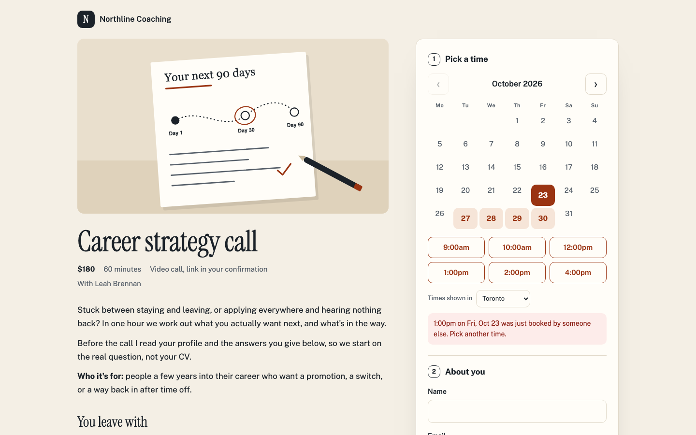

# Northline: one-page booking

A coaching call sold and booked on one page. The left side is the pitch: cover image, price, the business's own description and what the customer leaves with. On the right, one card has the whole booking in order: pick a time, answer four questions, pay. Nothing opens a new page until the customer is booked.

> Uses the `book` page and custom fields, which the developer portal accepts. Businesses see `book` pages on their booking page. Because the call is paid when booking, **Pay** takes the customer to Stripe's secure checkout. See [docs/booking-themes.md](../../docs/booking-themes.md#one-page-booking-the-book-page-preview).



| Ready to pay | Something missing |
| --- | --- |
|  |  |

| Phone | Phone, booking | Booked |
| --- | --- | --- |
|  |  |  |

When someone else takes the time first, the message from Octabiz is shown as it is, and the times reload:



## What's in it

```
theme.json          tokens (paper, ink, rust; Instrument Serif and Public Sans), pages.book and four custom fields
booking/book.html   the page: the pitch, and the booking card with the elements Octabiz fills
booking/book.css    layout; every colour and corner comes from var(--bk-*)
booking/book.js     calendar, times, the 10-minute hold, and Pay, all through window.octabizBooking
preview.json        a sample business for the preview tool (not uploaded)
preview/cover.svg   the sample business's cover image (not uploaded: covers belong to the business)
```

## What it shows you

- **The `book` page.** One page in place of `service` and `details`. Its data is `org`, `service`, `fields` and `timezone`.
- **Octabiz fills three parts in your tokens:**
  - `data-bk="description"`: the business's formatted text. Template values are always escaped, so this is how bold text and lists get through.
  - `data-bk="fields"`: name, email and the four questions from `fields` in `theme.json`.
  - `data-bk="payment"`: the amount due. **Pay** then sends the customer to Stripe's checkout, so your page never sees card details.
- **Hold on pick.** Clicking a time calls `hold()` straight away, so the time can't go while the customer types. A countdown shows how long is left, and when it runs out the page asks for the time again.
- **One call to finish.** **Pay** calls `readFields()`. That returns `null` and marks the form when something is missing. Otherwise it calls `book()`, which takes the payment and then opens **You're booked**.
- **A cover that may not exist.** Templates can't leave out an ``, so `book.js` removes it when the business has no cover.
- **A phone layout.** The pitch comes first, and a **Book a time · $180** bar jumps to the card. It hides itself once the card is on screen.

## Custom fields

```json
{ "id": "profile_url", "type": "url", "label": "Link to your LinkedIn or portfolio", "required": true },
{ "id": "current_role", "type": "text", "label": "What do you do now?", "required": true, "maxLength": 120 },
{ "id": "stage", "type": "select", "display": "chips", "label": "Where are you right now?", "required": true, "options": [...] },
{ "id": "goal", "type": "textarea", "label": "What would make this hour worth it?", "maxLength": 600 }
```

The coach sees the answers on the appointment and can print them in the confirmation email as `{{ answers.goal }}`.

## Run it

```bash
node tools/preview.mjs examples/booking-template-northline-one-page    # → http://localhost:4300
node tools/validate.mjs examples/booking-template-northline-one-page
node tools/pack.mjs examples/booking-template-northline-one-page       # → dist/booking-template-northline-one-page-1.0.0.zip
```

Add `?error=taken` to see a time go while you pick it, `?error=payment` to see a declined card, and `?bar=0` to hide the preview bar.
